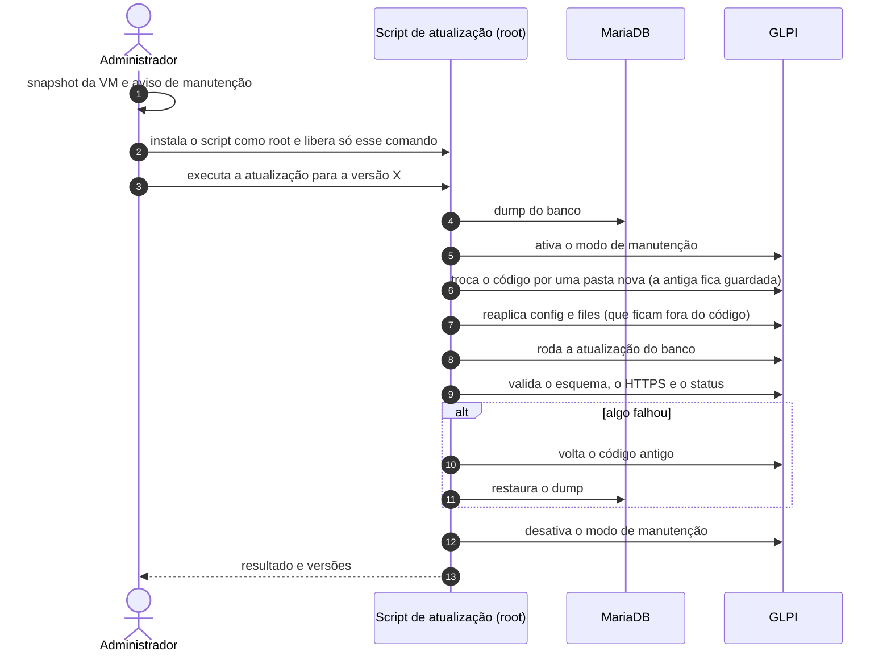
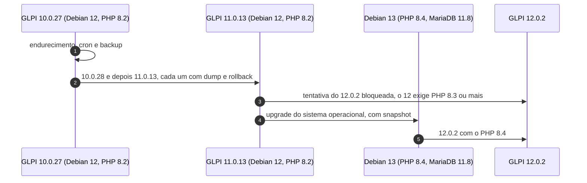

# Análise e Melhorias de um Servidor GLPI

    

## Sumário

1. [Objetivo](#1-objetivo)
2. [Stack](#2-stack)
3. [Arquitetura](#3-arquitetura)
    - 3.1. [Diagrama de fluxo](#31-diagrama-de-fluxo)
    - 3.2. [Estrutura de diretório](#32-estrutura-de-diretório)
    - 3.3. [Segurança da operação](#33-segurança-da-operação)
4. [Variáveis de configuração](#4-variáveis-de-configuração)
5. [Infraestrutura e execução](#5-infraestrutura-e-execução)
6. [Guia do desenvolvedor](#6-guia-do-desenvolvedor)

> **Projeto de portfólio.** Registro de um trabalho real de administração: auditoria, correção, atualização e limpeza de um servidor GLPI (service desk de TI) em produção. Endereços, nomes de máquina, domínios, usuários e caminhos são **genéricos** (`10.0.0.x`, `suporte.empresa.local`). Os scripts originais ficaram no servidor, então este repositório documenta o **processo, as decisões e os resultados**, com alguns exemplos de configuração.

## 1. Objetivo

Partir de um servidor GLPI antigo, sem endurecimento e sem manutenção, e levá-lo a uma instalação **atual, protegida, organizada e com rotina de operação**, sem perder dados e com como voltar atrás em cada etapa.

### 1.1. De onde partimos, até onde estamos

| Item | No começo | Agora |
|---|---|---|
| GLPI | 10.0.27 (série legada) | **12.0.2** |
| Sistema | Debian 12 | **Debian 13.7** |
| PHP | 8.2 | **8.4** |
| Banco | MariaDB 10.11, porta 3306 aberta na rede | **MariaDB 11.8.6**, só em `127.0.0.1` |
| Firewall | nenhum | **ufw** (22, 80 e 443) |
| Proteção de acesso | sem fail2ban, sem atualizações automáticas, SSH padrão | **fail2ban**, **unattended-upgrades** e SSH endurecido |
| Segredos | `config_db.php` e `glpicrypt.key` legíveis por qualquer usuário | permissão `640` |
| Ações automáticas | execução "interna" (só quando alguém abre o sistema) | **cron de sistema a cada minuto**, tarefas em modo CLI (51 tarefas, nenhuma com erro) |
| Notificações por e-mail | com falhas de SMTP e **7.410 mensagens paradas** na fila | desativadas (o envio passou para outra ferramenta) e fila limpa |
| Backup | nenhum visível | **diário** às 02:30, retenção de 14 dias |
| RAM | 1,9 GB, com swap em uso | ~5,8 GB |
| Disco usado | 11 GB | **7,6 GB** (17%) |
| `/var/log` | 1.060 MB | 60 MB |
| Relógio | sem sincronização (após o upgrade para o Debian 13) | sincronizado (NTP) |
| Plug-ins | 7 registrados, nenhum ativo e nenhum no disco (aviso permanente na tela) | **0**, tabelas removidas com backup |
| VM | não subia sozinha quando o servidor físico reiniciava | sobe em segundo plano na inicialização |

### 1.2. O que foi feito, em ordem

1. **Análise** (somente leitura): 18 pontos de melhoria, em crítico, médio, desempenho e logs. Veja [`docs/analise-inicial.md`](docs/analise-inicial.md).
2. **Endurecimento**: rede, firewall, permissões, SSH, PHP, Apache, cron, backup e rotação de logs. Veja [`docs/endurecimento.md`](docs/endurecimento.md).
3. **E-mail e ações automáticas**: notificações desativadas e todas as tarefas em modo CLI.
4. **Migração**: 10.0.27 → 10.0.28 → 11.0.13 e, depois de atualizar o sistema operacional, → **12.0.2**. Veja [`docs/migracao.md`](docs/migracao.md).
5. **Limpeza, início automático da VM e remoção dos plug-ins**. Veja [`docs/operacao-e-limpeza.md`](docs/operacao-e-limpeza.md).
6. **Fechamento do acesso privilegiado** e levantamento das próximas melhorias (acesso externo, backup na nuvem, abertura automática de chamados). Veja [`docs/pendencias-e-proximos-passos.md`](docs/pendencias-e-proximos-passos.md).

## 2. Stack

| Camada | Tecnologia |
|---|---|
| Aplicação | GLPI 12.0.2 |
| Sistema | Debian 13.7 (kernel 6.12) em uma VM do VirtualBox, num servidor físico Windows |
| Web | Apache 2.4 com `mod_php` (prefork), HTTPS com certificado de uma CA interna |
| Linguagem | PHP 8.4 (OPcache, APCu, Redis, intl, gd, ldap, bcmath, sodium) |
| Banco e cache | MariaDB 11.8 e Redis local |
| Segurança | ufw, fail2ban (backend `systemd`), unattended-upgrades, cabeçalhos HSTS e relacionados |
| Operação | scripts em shell, `cron`, `logrotate`, Agendador de Tarefas do Windows |

## 3. Arquitetura

### 3.1. Diagrama de fluxo

Atualização de uma versão do GLPI (padrão usado em cada salto de versão):



Caminho de versões:



### 3.2. Estrutura de diretório

```
README.md                              Este arquivo
docs/
    analise-inicial.md                 Os 18 achados da análise, por gravidade
    endurecimento.md                   O que foi aplicado, o que falhou e como foi corrigido
    migracao.md                        10.0.27 até 12.0.2, incluindo o upgrade do Debian
    operacao-e-limpeza.md              Limpeza, início automático da VM, plug-ins e relógio
    pendencias-e-proximos-passos.md    O que falta e as opções avaliadas
exemplos/
    linux/                             Configurações de referência (cron, fail2ban, journald, MariaDB)
    windows/                           Tarefa que sobe a VM na inicialização do servidor físico
```

### 3.3. Segurança da operação

As etapas que exigiam root seguiram sempre o mesmo modelo, para dar o **mínimo de acesso pelo mínimo de tempo**:

- O script a executar é copiado para `/root`, com dono `root` e permissão `700`, então nenhum outro usuário consegue alterá-lo.
- A regra do `sudo` liberava **somente a linha de comando exata** daquele script, sem curinga (`*`), que permitiria apontar para qualquer arquivo.
- Cada nova regra **substituía a anterior** (o arquivo era sobrescrito), então só existia uma regra por vez.
- Antes de qualquer alteração, havia dump do banco, backup das configurações e, nas mudanças grandes, snapshot da VM.
- No fim, a regra e os scripts em `/root` foram removidos.

## 4. Variáveis de configuração

Valores aplicados no servidor (a lista completa e o motivo de cada um estão em [`docs/endurecimento.md`](docs/endurecimento.md)):

| Área | Configuração | Valor |
|---|---|---|
| PHP | `memory_limit` | 256M (era 128M) |
| PHP | `upload_max_filesize` e `post_max_size` | 50M e 60M (eram 2M e 8M) |
| PHP | `session.use_strict_mode` | 1 |
| MariaDB | `bind-address` e socket do systemd | `127.0.0.1` e socket Unix |
| MariaDB | `innodb_buffer_pool_size` | 256M |
| Apache | `ServerTokens` e `ServerSignature` | `Prod` e `Off` |
| Cron do GLPI | `/etc/cron.d/glpi` | a cada minuto, como `www-data`, em modo CLI |
| Backup diário | horário e retenção | 02:30 e 14 dias |
| journald | tamanho e tempo | 200 MB e 1 mês |
| ufw | portas liberadas | 22, 80 e 443 |
| fail2ban | backend do jail do SSH | `systemd` (o Debian 12 não tem `auth.log`) |

## 5. Infraestrutura e execução

Servidor físico Windows, com o VirtualBox, e uma VM Debian com o GLPI. Para reproduzir o processo, na ordem:

1. **Análise em leitura** do ambiente, sem root, para listar os achados.
2. **Endurecimento** com um script único e backup antes (veja o modelo de acesso na seção 3.3).
3. **Aumentar a RAM** da VM e **tirar um snapshot**, com a VM desligada.
4. **Pré-teste** (não altera a produção): disco, tamanho do banco, plug-ins, integridade do esquema, download e checagem dos pacotes e requisitos da versão nova numa pasta temporária.
5. **Atualizar o GLPI** em saltos, cada um com dump, manutenção e rollback automático.
6. **Atualizar o Debian** (quando o PHP exige) em segundo plano (`systemd-run`), com log, e conferir tudo depois do reinício.
7. **Limpar**, organizar os backups, remover o que não é usado e remover o acesso privilegiado.
8. **Início automático da VM**: tarefa na inicialização do Windows (veja `exemplos/windows/`).

## 6. Guia do desenvolvedor

**Lições aprendidas**

- Sempre confirmar a **versão do PHP exigida** antes de planejar o salto de versão: o GLPI 12 exige PHP 8.3 ou mais, e o Debian 12 tem o 8.2. A saída foi atualizar o sistema operacional, em vez de adicionar um repositório de terceiros ao servidor.
- No GLPI 12, os comandos do console **perderam o prefixo `glpi:`** (`database:update`, `cache:clear`, `system:check_requirements`). Scripts feitos para o 10 e o 11 precisam descobrir o nome válido em cada versão.
- O `bind-address` do MariaDB **não vale** se o `mariadb.socket` do systemd abrir a porta. É preciso sobrescrever o socket também.
- Depois do upgrade para o Debian 13, o `systemd-timesyncd` foi removido e o relógio ficou sem sincronização, o que afeta certificados, SLA e o fail2ban. Confira `timedatectl` depois de qualquer upgrade grande.
- No Debian sem `auth.log`, o fail2ban precisa de `backend = systemd`.
- O aviso "Você tem N plug-ins para atualizar" vem do **banco**, não do disco: pasta de plug-ins vazia não resolve se os registros continuam lá.
- Tarefa agendada do Windows para a VM: com `0x800706fc`, use o nome completo da conta (`whoami`), e a tarefa precisa rodar com o **usuário dono da VM**, não como SYSTEM.
- O **log do GLPI usa UTC**: some o fuso ao comparar horários.

**Como voltar atrás**

- Cada salto de versão guarda o **código anterior** em uma pasta ao lado e um **dump** do banco, e o script restaura sozinho se algo falhar.
- Os snapshots da VM são a rede de proteção das mudanças grandes (sistema operacional, versão do banco).
- As pastas de rollback e os snapshots devem ser apagados depois de alguns dias de uso estável, porque ocupam espaço e perdem valor.

**O que ficou de fora**

Os scripts originais não estão aqui. O que se pode pegar como referência são as configurações de `exemplos/`, que são genéricas.

## Licença

MIT. Veja o arquivo [LICENSE](LICENSE).
